# ITU-CS-464-LAB-07-BSSE23040

CS-464 Game Development, Lab 07: a mobile menu system with 10 screens. Mohsin Raza Ojla, BSSE23040.

- **Demo video:** VIDEO_LINK_HERE
- **Game:** *Comet Dash*, a made-up one-thumb space runner. The menus are the project. There is only a tiny stand-in for the real game, so the pause menu and the results screen have something to belong to.
- **Unity version:** 6000.6.2f1 (made and tested in this one only).

## How to run it

1. Install Unity **6000.6.2f1** with Unity Hub, then **Add > Add project from disk** and pick this folder.
2. Open `Assets/Scenes/Menus.unity`. Everything is in that one scene.
3. In the **Game** view choose a portrait size. I used **1080 x 1920** (Simulator view with a phone also works). Press **Play**.
4. Click, or tap on a phone. **Escape** works like the Android back button. On the title screen, tap anywhere.

The menus save coins, ships, stars and settings in `PlayerPrefs`, so they are still there next time. **Settings > Reset progress** (two taps) puts everything back to the start.

The button blips and the quiet music in the background are generated in code, so there are no audio files. The two sliders in Settings control them.

## The ten screens and how they connect

| # | Screen | Forward | Back |
|---|---|---|---|
| 1 | Title | tap anywhere: Main menu | Escape quits the app |
| 2 | Main menu | Play: Mode select, Loadout, Shop, Settings, Credits | Title |
| 3 | Mode select | Next: Level select | Main menu |
| 4 | Level select | Start: the game | Mode select |
| 5 | Loadout | Unlock: Shop | Main menu (or Results) |
| 6 | Shop | buy things, claim the gift | the screen it was opened from |
| 7 | Settings | change values, Reset progress | the screen it was opened from (Main menu or Pause) |
| 8 | Pause | Resume, Restart, Settings, Quit | Resume |
| 9 | Results | Next sector or Try again, Retry or Loadout, Menu | Main menu |
| 10 | Credits | rolls by itself | Main menu |

Between 8 and 9 there is the stand-in game screen (the 11th screen in the scene, not one of the 10). It has a **pause** button and a **Finish run** button. The longer you wait before finishing, the more points you have: 100 points is one star, 250 two, 400 three. Under 100 is a lost run, and the results screen changes for that.

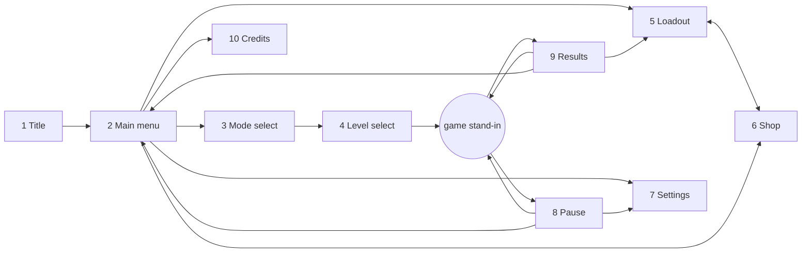

Every screen has a way forward or a way back, and Escape does the same thing as the back arrow. Back is always the same round arrow in the top left corner.

## Design choices that apply to every screen

**Colour.** A dark indigo night sky as the base, with one warm accent: amber. Indigo and yellow-orange are almost opposites on the colour wheel, so the amber always jumps out of the blue. I use it only for the main action of a screen and for rewards (stars, coins, score). Teal is a calm second accent (ship, chips, stat bar). Coral only means "careful". Roughly: 60% dark indigo, 30% lighter indigo panels, 10% accents.

| Colour | Hex | Used for |
|---|---|---|
| Sky top / bottom | `#241F6B` / `#0A0922` | background gradient |
| Panel | `#2A2575` | cards and panels |
| Panel high | `#3B34A8` | secondary buttons |
| Panel low | `#1D1A55` | tracks, info boxes, disabled backgrounds |
| Line | `#6C63FF` | thin outlines |
| Ink | `#F6F4FF` | main text |
| Dim | `#BDB8F2` | secondary text |
| Amber | `#FFC233` | main action, rewards, picked state |
| Teal | `#2DD4BF` | secondary accent |
| Coral | `#FF6B81` | quit, reset, danger |
| Mint | `#5BE584` | a switch that is on |

Contrast of the text pairs I used (WCAG ratio, 4.5 is the usual minimum): Ink on panel 11.9, Dim on panel 7.0, Ink on secondary button 8.6, dark text on amber 10.4, dark text on coral 6.8, dark text on teal 7.9, amber on panel 8.0. Disabled text is the only one that is lower, 4.5, and that is on purpose.

**Type.** One family, **Inter**, in two weights (SemiBold for titles and buttons, Regular for body). Sizes on a 1080-wide canvas: logo 215, screen titles 76 to 112, buttons 40 to 78, body 38 to 48, small labels 30 to 34. Nothing is smaller than 30, which is about 11 dp on a normal phone.

**Layout.** The canvas scales with the screen width (reference 1080 x 1920, match = width), so layouts stay the same width on every phone and just get taller or shorter. Top elements are anchored to the top, buttons to the bottom, and the floating middle parts to a fraction of the height. A `SafeArea` object keeps everything out of notches and rounded corners. Lists use layout groups (grids for sectors and shop, a vertical group for settings and credits).

**Touch targets.** On a phone that is 1080 px wide, 1 dp is about 2.8 px, so 48 dp is about 135 px. Buttons are 130 to 170 px tall, round buttons 132 px, the slider has an invisible 110 px band around it. Neighbouring buttons have at least 20 px between them.

**Feedback.** Every button shrinks and gets darker while it is held and springs back when released, and it plays a small blip. Things that are not allowed shake and show a message at the top ("Not enough coins"). A locked thing always says why.

**Hierarchy and grouping.** Each screen has one amber button at most. Titles are bigger than body text, and related things sit in one panel with the same spacing (counters together, stats together, settings rows together).

### Motion

All motion is written by me in `Tween.cs` (coroutines and easing functions, no tween package). It runs on unscaled time, so menus still animate when the pause menu sets `Time.timeScale` to 0.

| Ease | Where it is used | Why |
|---|---|---|
| **OutCubic** | screens sliding in, things rising into place | starts fast and settles gently, feels responsive but calm |
| **InOutCubic** | the screen that leaves, the switch knob | starts and ends softly, good for a move between two resting places |
| **InCubic** | things leaving (ship in the loadout, toast, old tab) | accelerates away, so it leaves quickly and gets out of the way |
| **OutBack** | pops, the logo, panels, buttons springing back | a small overshoot says "this just arrived" and feels alive |
| **OutElastic** | the stars on the results screen | a springy bounce for the biggest reward only |
| **OutQuad / OutCubic** (counters) | coin counts, the score count-up | fast at first, slows near the final number so it can be read |
| **InOutSine** | floating ship and planet, pulsing "tap to start" | smooth to and fro, no hard edges |
| **Linear** | credits roll, the decaying shake | a constant speed is what makes credits comfortable to read |

Shared transitions (`ScreenManager`): going forward, the new screen slides in from the right (`OutCubic`, 0.38 s, from 35% of the width) while it fades in, and the old one slides out to the left (`InOutCubic`, less far, 25%) while it fades out. Going back is the mirror image. The pause menu is an overlay, so it does not slide: it fades in over the game (0.2 s). A transparent layer blocks taps while a transition runs, so nobody can double tap into a broken state.

## Screen by screen

Each section has the annotated colour screenshot (numbers match the list under it), then the plain colour screenshot next to its greyscale copy. The greyscale copies were made by removing the saturation of the colour screenshot (luminance, not an average of the channels).

### 1. Title

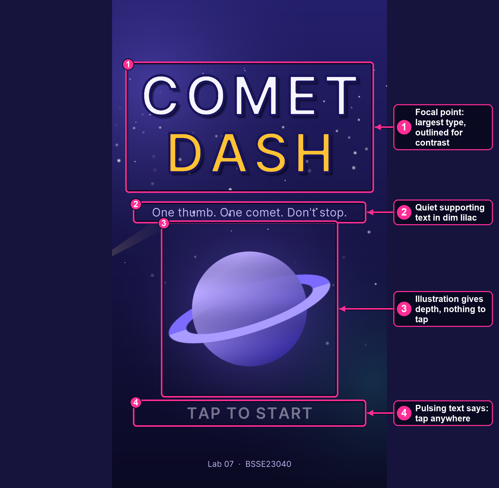

| Colour | Greyscale |
|---|---|
|  |  |

**Purpose:** first impression and a calm entry point. Nothing to decide, just start.

**Principles and techniques**
1. *Focal point.* The logo is by far the biggest thing. It has a dark outline and a soft shadow (a custom TextMesh Pro material), so it keeps its contrast over the stars. COMET is white and DASH is amber, so the name has two parts.
2. *Hierarchy.* The tagline is much smaller and dimmer than the logo.
3. *Depth.* A planet with a glow and a comet that crosses the sky now and then fill the empty middle. They are not tappable and they are not the brightest thing, so they do not compete with the logo.
4. *Affordance.* "TAP TO START" pulses. The whole screen is the button, and the pulse is what tells you that.

**Tweens**
- Logo drops in: move `OutBack` 0.8 s plus fade `OutQuad` 0.4 s. The overshoot makes it look like it landed.
- Tagline: fade `OutQuad` 0.6 s, delayed 0.55 s, so the order of reading is logo, tagline, prompt.
- Prompt: fade in, then a loop `InOutSine` 0.9 s between full and 35% opacity. The sine curve has no hard turning point, so it looks like breathing and not like blinking.
- Planet floats ±14 px, `InOutSine` 2.4 s. The comet crosses with `OutQuad` 1.6 s, then waits 3.5 s.

**Greyscale check:** the white logo, the grey planet and the dim prompt are all easy to tell apart. No change needed.

### 2. Main menu


| Colour | Greyscale |
|---|---|
|  |  |

**Purpose:** the hub. From here you reach everything, and the first thing to do (Play) is obvious.

**Principles and techniques**
1. *One primary action.* Play is the biggest button, the only amber one, and has an icon.
2. *Secondary action.* Loadout and Shop are smaller and blue (panel high colour), with icons.
3. *Tertiary action.* Settings and Credits are outline only, so they are there but quiet.
4. *Grouping.* Coins and gems sit together in the top right, where players look for them.
5. *Hero.* The ship you have equipped floats over a teal glow, so the main menu shows your own progress.
6. *Grouping.* Who you are (level badge and name) sits in the top left.

**Tweens**
- Every block pops in from top to bottom: scale 0.85 to 1 with `OutBack` 0.4 s, fade `OutQuad` 0.25 s, 0.07 s apart. The order follows the way people read, so the eye is led down to Play.
- The ship floats up and down ±16 px, `InOutSine` 1.8 s.
- Button press: scale to 0.94 `OutQuad` 0.08 s, back with `OutBack` 0.25 s.

**Greyscale check:** Play is the biggest light area on the screen, the blue buttons are mid grey, and the outline buttons are darkest, so the three levels of importance still read. No change needed.

### 3. Mode select


| Colour | Greyscale |
|---|---|
| 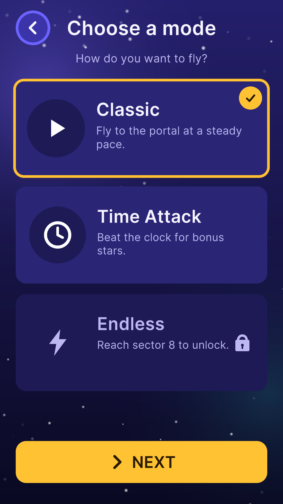 |  |

**Purpose:** choose how to play before choosing a sector.

**Principles and techniques**
1. *Selected state.* The picked card has a thick amber border and a tick badge, so it does not depend on colour alone (the border is also the lightest outline in greyscale).
2. *Disabled state.* Endless is locked: darker card, dim text, a lock icon, and a sentence saying how to unlock it. Tapping it shakes it and shows a message.
3. *Thumb reach.* Next sits at the bottom, where the thumb already is.
4. *Consistency.* The back arrow is always in the same place.
5. *Grouping.* Each card has the same parts in the same places: icon, name, one line of text.

**Tweens**
- Cards rise into place one after another: move `OutCubic` 0.45 s, fade `OutQuad`, 0.09 s apart.
- Picking: border colour `OutQuad` 0.2 s, card grows to 1.02 with `OutBack` 0.3 s, the tick pops with `OutBack` 0.35 s.
- Tapping a locked card: a 0.4 s shake that dies away (linear, so the swing fades evenly) and a message that drops in with `OutBack` and leaves with `InCubic`.

**Greyscale check:** the picked card, the normal card and the locked card are three different greys, and the lock icon and the text also say it. No change needed.

### 4. Level select

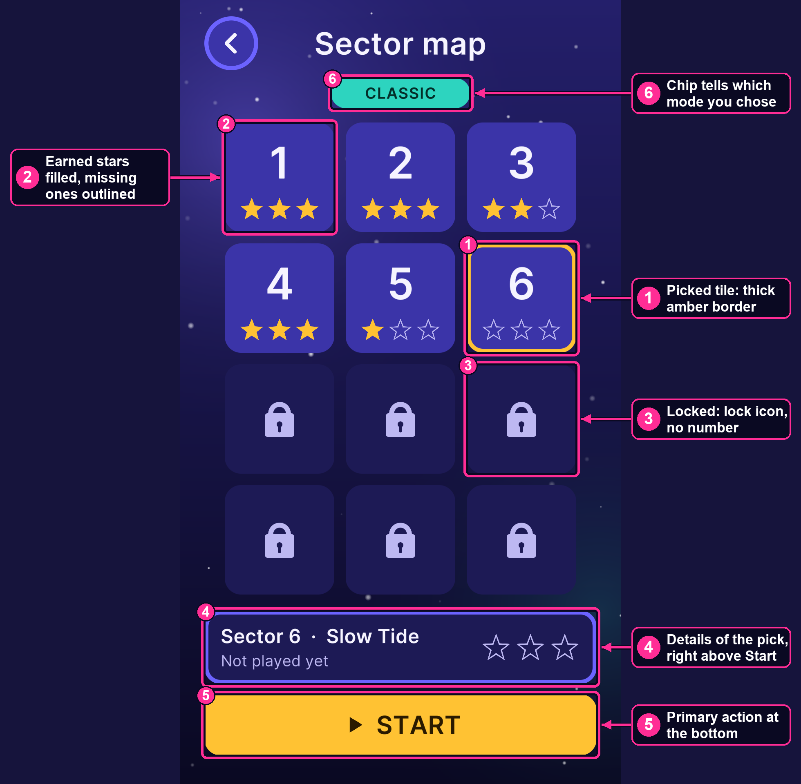

| Colour | Greyscale |
|---|---|
|  |  |

**Purpose:** pick one of 12 sectors and see how you did in it.

**Principles and techniques**
1. *Selected state.* Thick amber border.
2. *Progress.* Earned stars are filled and the missing ones are outlines, so you can see what is still possible.
3. *Locked.* Darker tile, a lock, and no number.
4. *Summary.* The panel under the grid repeats the name, the best score and the stars of the picked sector, close to Start.
5. *Primary action.* Start is amber, full width, at the bottom.
6. *Context.* A small teal chip reminds you which mode you chose.

The 12 tiles are a 3 x 4 grid made with a `GridLayoutGroup`.

**Tweens**
- The tiles pop in as a wave from the top left: scale 0.7 to 1 with `OutBack`, delayed by (row + column) x 0.05 s. A wave shows that it is a map and not a list.
- Picking a tile: a small punch (scale 1.08 back to 1, `OutBack` 0.35 s) and the info panel punches too, so the eye follows the change.

**Greyscale check:** locked tiles are clearly darker than open tiles, and the picked tile is the only one with a bright border. No change needed.

### 5. Loadout

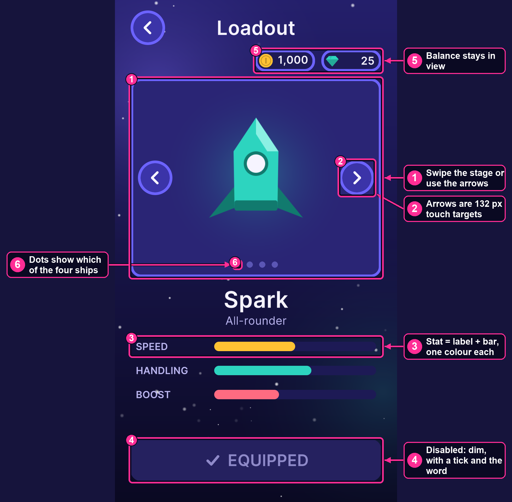

| Colour | Greyscale |
|---|---|
|  | 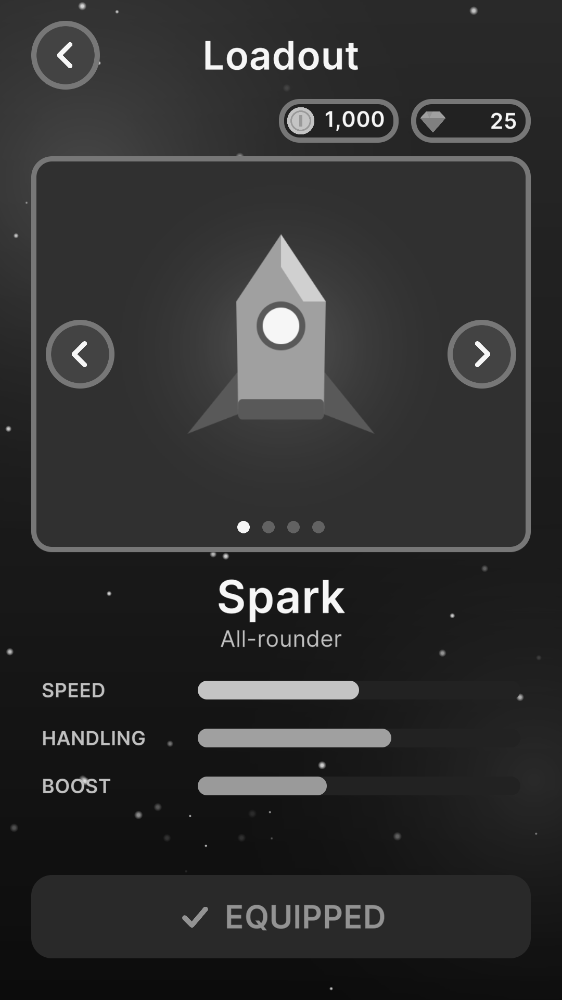 |

**Purpose:** look at the ships, compare their stats, and equip one.

**Principles and techniques**
1. *Direct manipulation.* The stage can be swiped as well as tapped.
2. *Touch targets.* The arrows are 132 px circles.
3. *Stats.* Each stat is a word plus a bar, in a different colour each (amber, teal, coral), so it is readable without the colour too.
4. *Disabled state.* The Equipped button is dim, but it keeps a tick and the word EQUIPPED. A ship you do not own turns it into "UNLOCK 800" with a lock, and pressing it opens the shop.
5. *Visibility.* The coin and gem counters stay on screen while you decide what to buy.
6. *Position.* Four dots show which of the four ships you are looking at.

**Tweens**
- Browsing: the ship slides out and fades (`InCubic` 0.16 s), then the next one slides in from the other side (`OutCubic` 0.3 s). The direction matches the arrow or the swipe.
- The stat bars grow from zero: `OutCubic` 0.5 s, each 0.08 s after the one before.
- Equip: the ship punches 1.15 with `OutBack`.

**Greyscale check:** the stat bars are three slightly different greys, but each has its label, so nothing depends on colour. The disabled button is the dimmest thing but its tick and word are still readable. No change needed.

### 6. Shop

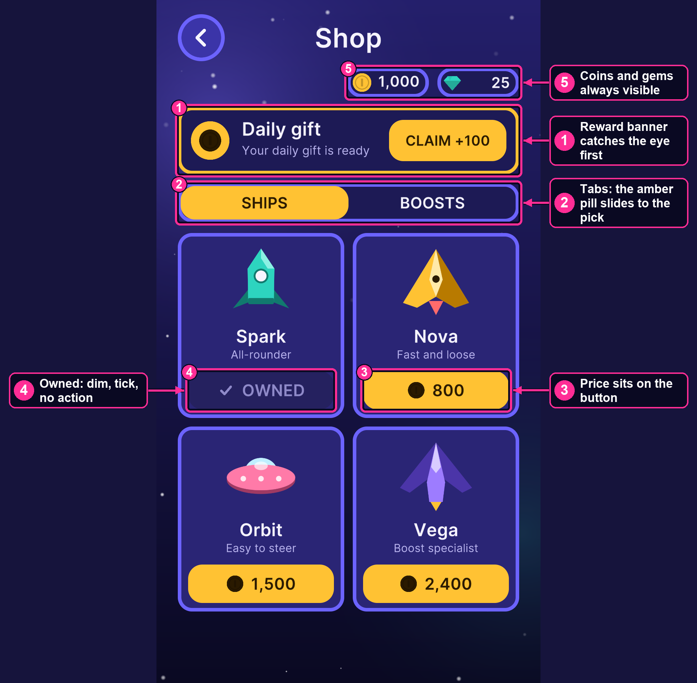

| Colour | Greyscale |
|---|---|
|  |  |

**Purpose:** spend coins on ships and boosts, and claim the free daily gift.

**Principles and techniques**
1. *Reward first.* The daily gift banner has an amber outline and sits right under the counters.
2. *Tabs.* Ships and Boosts. The amber pill shows which tab is open, and the label of the open tab is dark on amber.
3. *Price on the button.* The coin icon and number are the button, so there is nothing else to tap.
4. *Owned.* The button goes dim and says OWNED with a tick. It cannot be pressed.
5. *Balance in view.* Coins and gems stay at the top.
The cards use a `GridLayoutGroup` with two columns.

**Tweens**
- Switching tabs: the old grid slides 120 px and fades out (`InCubic` 0.2 s) while the new one slides in from the same side (`OutCubic` 0.32 s). The pill under the labels slides with `OutCubic` 0.25 s.
- Buying: the card punches (1.06, `OutBack`), and the coin number counts down (`OutQuad` 0.6 s) instead of jumping, so you see what it cost.
- Not enough coins: the card shakes and a message says why.
- Claiming the gift: the button punches, the counter counts up, and the button turns into a dim TOMORROW.

**Greyscale check:** the OWNED button is clearly dimmer than the price buttons, and the amber tab is the lightest area of the tab bar. No change needed.

### 7. Settings


| Colour | Greyscale |
|---|---|
| 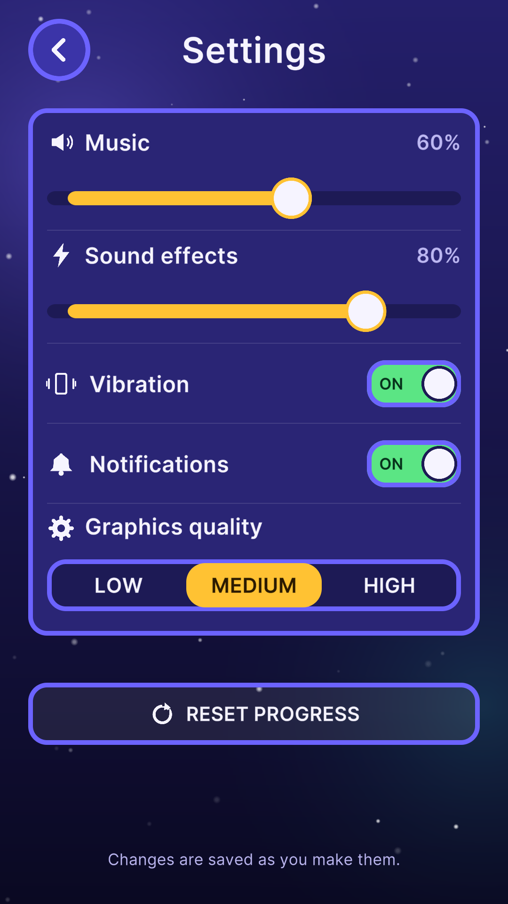 | 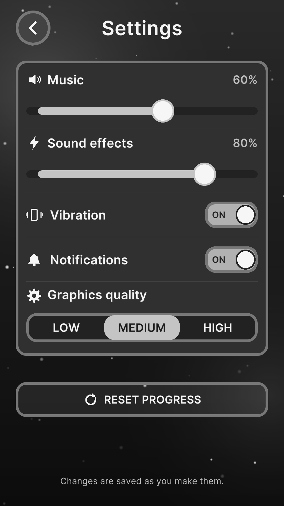 |

**Purpose:** change sound, vibration, notifications and graphics quality. Everything is saved straight away.

**Principles and techniques**
1. *Sliders.* Big 88 px handle and a 110 px tall touch band. The percentage is written next to the name.
2. *Switches.* The word ON or OFF is written inside the switch, and the knob moves to the other side, so the state is not only a colour.
3. *Segmented control.* Low / Medium / High, exactly one is picked and it is marked with the amber pill.
4. *Danger.* Reset progress is apart from the rest and needs two taps. The first tap changes the label to "TAP AGAIN TO CONFIRM" and draws a coral border, and it relaxes after 3 seconds.
5. *Grouping.* All rows live in one panel with a thin divider between them and an icon in front of each name. The rows are laid out by a vertical layout group.

**Tweens**
- Rows pop in one after another (scale and fade, `OutBack` / `OutQuad`).
- Switch: the knob slides `InOutCubic` 0.22 s and the track changes colour with the same curve, so they move together.
- Segmented pill: `OutCubic` 0.25 s.

**Greyscale check (a change was needed):** in the first version the "ON" text was white on a bright green track and the white knob almost disappeared in greyscale. I made the ON text dark, gave the knob a dark rim, and checked again. Now the text and the knob are both clear.

### 8. Pause


| Colour | Greyscale |
|---|---|
| 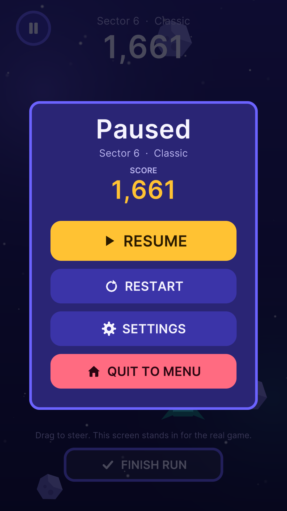 |  |

**Purpose:** stop the game without losing it, and offer the four things you may want to do.

**Principles and techniques**
1. *Modal.* It is an overlay: the game stays visible but dimmed behind it, and `Time.timeScale` is 0, so the score really stops (I check that in my test).
2. *Primary action.* Resume is amber and the biggest.
3. *Destructive action.* Quit to menu is coral, last in the list, and has both a home icon and words.
4. *Context.* The sector name and the current score are reminded at the top of the panel.
5. *Round trip.* Settings opens the settings screen, and its back arrow returns here.

**Tweens**
- The dark layer fades to 72% (`OutQuad` 0.25 s). The panel scales from 0.82 to 1 with `OutBack` 0.38 s. The four buttons pop in after each other.
- Closing it fades the overlay out (`InQuad` 0.2 s), so it leaves quicker than it came.

**Greyscale check:** Resume is clearly the lightest. Quit is lighter than Restart and Settings (coral is brighter than the blue), and it also has the icon and its own words, so it does not rely on that difference. No change needed.

### 9. Results


| Colour | Greyscale |
|---|---|
|  |  |

**Purpose:** tell the player how the run went, in order of importance, and offer what to do next. A lost run uses the same screen: it says "Run over", the stars stay empty, and the buttons become Try again, Loadout and Menu.

**Principles and techniques**
1. *Stars first.* They are the biggest thing and the middle one is the biggest star. Earned stars are filled amber, missing ones are outlines.
2. *Score.* The biggest number, white on the panel.
3. *Reward badge.* NEW BEST only appears when the score really is a new best.
4. *Primary action.* Next sector is amber and full width. Retry and Menu are smaller and blue.
5. *Grouping.* Score, new best, coins earned and best score sit in one panel.
6. *Title.* Outlined, like the logo, because it is the big moment.

**Tweens**
- The numbers are revealed in order: title drops in (`OutBack` 0.55 s), stars pop one by one (`OutElastic` 0.75 s, 0.3 s apart), the score counts up (`OutCubic` 1.2 s), then the coins count up (`OutQuad` 0.9 s), then the badge pops (`OutBack` 0.5 s), and last the buttons rise (`OutCubic` 0.45 s). The buttons come last so the eye ends on what to do next.
- `OutElastic` is only used here. It is the strongest curve I use, so it is kept for the strongest moment.

**Greyscale check:** stars, score and the amber button are the three lightest things, in the same order as in colour. The NEW BEST badge is light with dark text. No change needed.

### 10. Credits

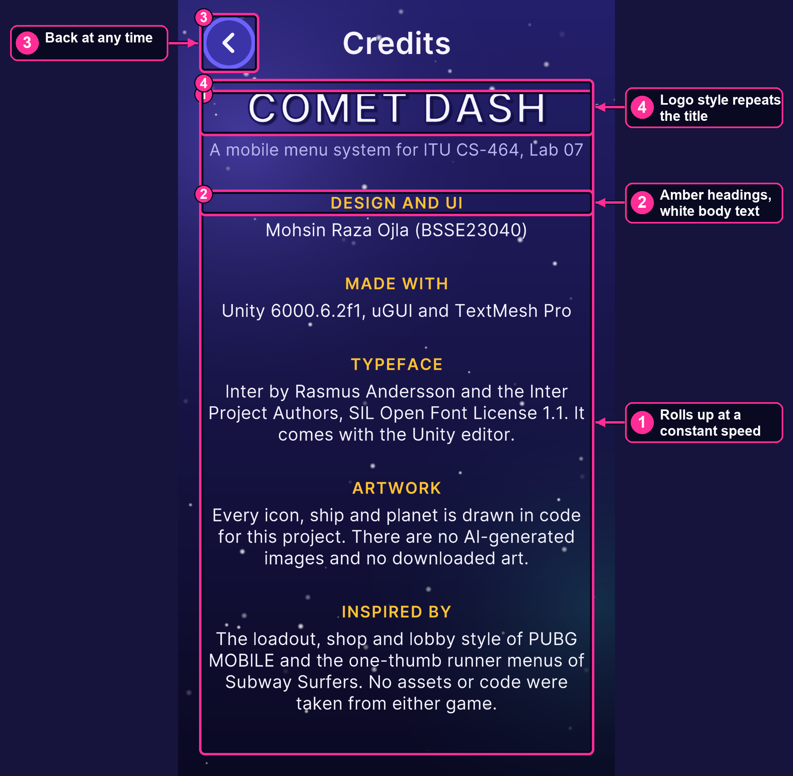

| Colour | Greyscale |
|---|---|
|  |  |

**Purpose:** say who made what and where the font and ideas come from.

**Principles and techniques**
1. *Reading comfort.* The text rolls up by itself at a constant 90 px per second. If you touch the screen it stops, so you can scroll by hand, and it carries on 1.5 seconds after you let go.
2. *Hierarchy.* Amber spaced capitals for headings, white text for the content.
3. *Way out.* The back arrow is always there.
4. *Consistency.* The logo uses the same outlined style as the title screen.

**Tweens**
- The roll is a `Linear` tween. A constant speed is the one case where easing would make it worse, because the text would speed up and slow down while you are reading it.

**Greyscale check:** the amber headings turn into a mid grey while the body text stays almost white, so the two are different, and the headings are also small spaced capitals. No change needed.

## What I changed after looking at the greyscale pictures

I looked at all ten greyscale copies. Only one thing had to change: the switches on the settings screen (see screen 7). The other places where two things could have merged, such as the quit button next to the blue buttons or the locked and open tiles, already had an icon, a word, a border or a different brightness.

## How I checked it

I wrote an editor script (not in the repo) that opens the scene in play mode and clicks the real buttons through the whole menu: title, main menu, mode, level, game, pause, settings and back, results, loadout, shop (buying, not having enough coins, boosts, the gift), reset, credits, and a second run to the next sector. After every step it checks which screen is open and what the data says. It was 52 checks and all of them pass. It also fails if anything logs an error, and nothing did. It found three real bugs while I was building (a back-button loop in the pause menu, the first tween of a session cancelling itself, and the loadout forgetting which ship you were looking at when you came back from the shop).

## Credits and references

- **Font:** [Inter](https://github.com/rsms/inter) by Rasmus Andersson and the Inter Project Authors, SIL Open Font License 1.1. I used the copy that ships with the Unity editor. The license text is in `Assets/Fonts/Inter-LICENSE.txt`.
- **Engine and packages:** Unity 6000.6.2f1, uGUI, TextMesh Pro.
- **Art:** every sprite (rounded boxes, icons, ships, planet, comet, rocks) is drawn by my own code in an editor script, with signed distance shapes. No AI-generated images, no downloaded art, no asset store packages.
- **Sound:** the blip and the music pad are made in code at runtime (`UISound.cs`).
- **Easing curves:** the formulas are the usual ones listed on [easings.net](https://easings.net) (Robert Penner's easing equations). The tween code around them is mine.
- **Inspiration only:** the calm one-thumb mood of *Alto's Odyssey* and the card-style shops and level maps of mobile runners like *Subway Surfers*. I did not take any asset or code from them.
- **Course:** ITU CS-464 Game Development lecture notes on colour, type, hierarchy and motion.

## Folders

```
Assets/Scenes     Menus.unity, the only scene
Assets/Scripts    all scripts: ScreenManager, one script per screen, Tween, PlayerData, small widgets
Assets/Art/UI     the sprites (PNG, drawn in code)
Assets/Fonts      Inter and its TextMesh Pro font assets, plus the license
Docs/screens      colour, annotated and greyscale screenshots used above
```

## Git

I worked on the `development` branch with small commits (data and tween code first, then the screens, then the sprites and the scene, then fixes). It was merged into `main` with a pull request.
