# ITU-CS-464-LAB-07-BSSE23040

CS-464 Game Development, Lab 07. A mobile menu system with 10 screens, by Mohsin Raza Ojla (BSSE23040).

- Demo video: VIDEO_LINK_HERE
- Unity version: 6000.6.2f1. I only made and tested it in this one.
- The game is called Comet Dash, a made-up one-thumb space runner. The menus are the real work. The "game" is a tiny stand-in so that the pause menu and the results screen have something to belong to.

## How to run it

1. Install Unity 6000.6.2f1 with Unity Hub. Use Add > Add project from disk and pick this folder.
2. Open `Assets/Scenes/Menus.unity`. Everything is in that one scene.
3. In the Game view pick a portrait size. I used 1080 x 1920. Then press Play.
4. Click with the mouse (or tap on a phone). Escape works like the Android back button. On the title screen you tap anywhere.

Coins, ships, stars and settings are saved with PlayerPrefs, so they are still there the next time. Settings > Reset progress (two taps) puts everything back to the start. The project has no sound.

## The ten screens and how they connect

| # | Screen | Goes forward to | Back goes to |
|---|---|---|---|
| 1 | Title | Main menu (tap anywhere) | Escape quits |
| 2 | Main menu | Mode select, Loadout, Shop, Settings, Credits | Title |
| 3 | Mode select | Level select | Main menu |
| 4 | Level select | the game | Mode select |
| 5 | Loadout | Shop (for a ship you don't own) | Main menu, or Results |
| 6 | Shop | nothing, you buy things here | whichever screen opened it |
| 7 | Settings | nothing | Main menu, or Pause |
| 8 | Pause | Resume, Restart, Settings, Quit to menu | Resume |
| 9 | Results | next sector or try again, retry or Loadout, Menu | Main menu |
| 10 | Credits | nothing, it rolls by itself | Main menu |

Between 8 and 9 there is the stand-in game screen. It is the 11th screen in the scene but not one of the ten. It has a pause button and a Finish run button. The longer you play before finishing, the higher the score: 100 points is one star, 250 is two and 400 is three. Under 100 counts as a lost run and the results screen changes to match.

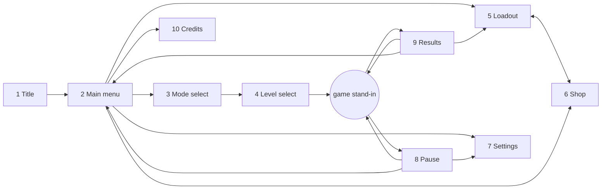

No screen is a dead end. The back arrow is always the round button in the top left, and Escape does the same thing.

## Design choices that apply everywhere

### Colour

The base is a dark indigo night sky with one warm accent, amber. Indigo and yellow-orange sit almost opposite each other on the colour wheel, so amber pops out of the blue without effort. I only use amber for the main button of a screen and for rewards (stars, coins, score). Teal is a calmer second accent, coral only ever means "careful". It is roughly 60% dark indigo, 30% lighter indigo panels and 10% accents.

| Colour | Hex | Used for |
|---|---|---|
| Sky top and bottom | `#241F6B`, `#0A0922` | the background gradient |
| Panel | `#2A2575` | cards and panels |
| Panel high | `#3B34A8` | secondary buttons |
| Panel low | `#1D1A55` | tracks, info boxes, disabled buttons |
| Line | `#6C63FF` | thin outlines |
| Ink | `#F6F4FF` | main text |
| Dim | `#BDB8F2` | secondary text |
| Amber | `#FFC233` | main action, rewards, the picked item |
| Teal | `#2DD4BF` | second accent |
| Coral | `#FF6B81` | quit, reset |
| Mint | `#5BE584` | a switch that is on |

Contrast ratios of the text pairs I used (4.5 is the usual minimum): Ink on panel 11.9, Dim on panel 7.0, Ink on a secondary button 8.6, dark text on amber 10.4, dark text on coral 6.8, dark text on teal 7.9, amber on panel 8.0. Only disabled text is lower, 4.5, and that is on purpose.

### Type

One family, Inter, in two weights: SemiBold for titles and buttons, Regular for body text. On the 1080 wide canvas the logo is 215, screen titles are 76 to 112, buttons 40 to 78, body text 38 to 48 and the smallest labels 30. Nothing is below 30, which is about 11 dp on a normal phone.

### Layout

The canvas scales with the screen width (reference 1080 x 1920), so every phone gets the same width and just more or less height. Things at the top are anchored to the top, buttons to the bottom, and the floating middle parts to a fraction of the height. A `SafeArea` object keeps everything out of notches and rounded corners. Grids and lists (sectors, shop, settings, credits) use layout groups.

### Touch targets

On a phone that is 1080 px wide, 1 dp is about 2.8 px, so 48 dp is about 135 px. Buttons are 130 to 170 px tall, round buttons are 132 px, and the slider has an invisible 110 px band around it. Neighbouring buttons are at least 20 px apart.

### Feedback

A button gets smaller and a bit darker while it is held, then springs back when you let go. Things that are not allowed shake and show a short message at the top ("Not enough coins"). A locked thing always says why it is locked.

### Hierarchy and grouping

There is one amber button per screen at most. Titles are bigger than body text, and things that belong together sit in one panel with the same spacing: the counters, the stats, the settings rows.

### Motion

All the motion comes from `Tween.cs`, which I wrote myself (coroutines plus easing functions, no tween package). It runs on unscaled time, so the menus still animate while the pause menu has set `Time.timeScale` to 0.

| Ease | Where | Why |
|---|---|---|
| OutCubic | screens sliding in, things rising into place | fast start and a gentle stop, so it feels quick but calm |
| InOutCubic | the screen that leaves, the switch knob | soft at both ends, good for moving between two resting places |
| InCubic | things leaving (old ship, toast, old tab) | speeds up as it goes, so it gets out of the way |
| OutBack | pop-ins, the logo, panels, buttons springing back | a small overshoot says "this just arrived" |
| OutElastic | the stars on the results screen | a springy bounce, kept for the biggest reward only |
| OutQuad and OutCubic | coin counters and the score count-up | fast first, slows down near the final number so it can be read |
| InOutSine | floating ship and planet, the pulsing "tap to start" | smooth to and fro, no hard turning point |
| Linear | the credits roll, the fading shake | constant speed is what makes credits easy to read |

Shared transitions live in `ScreenManager`. Going forward, the new screen slides in from the right (OutCubic, 0.38 s) while it fades in, and the old one slides out to the left (InOutCubic, not as far) while it fades out. Going back is the mirror image. The pause menu is an overlay, so it fades in over the game instead of sliding. A see-through layer blocks taps while a transition runs, so you can't double tap into a broken state.

## Screen by screen

Each section has the annotated colour screenshot (the numbers match the list under it), then the plain colour screenshot next to its greyscale copy. The greyscale copies are the colour screenshots with the saturation taken out (luminance, not an average of the channels).

### 1. Title


| Colour | Greyscale |
|---|---|
| 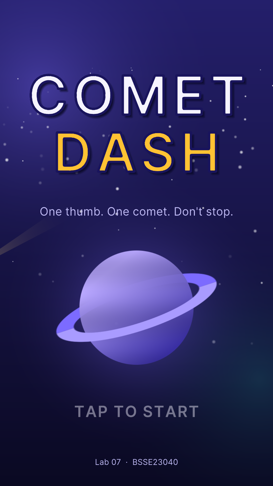 | 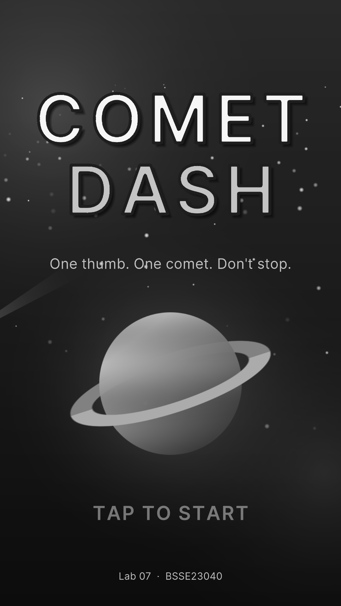 |

Purpose: a calm first screen with nothing to decide. You just start.

1. The logo is by far the biggest thing. It has a dark outline and a soft shadow (a custom TextMesh Pro material) so it stays readable over the stars. COMET is white and DASH is amber.
2. The tagline is much smaller and dimmer, so it clearly comes second.
3. The planet and the comet that crosses the sky now and then fill the empty middle. Nothing there can be tapped and nothing is brighter than the logo.
4. "TAP TO START" pulses. The whole screen is the button, and the pulse is what says so.

Motion: the logo drops in with a move (OutBack, 0.8 s) plus a fade (OutQuad, 0.4 s), and the overshoot makes it look like it landed. The tagline fades in 0.55 s later, then the prompt, so you read them in that order. The prompt then loops between full and 35% opacity (InOutSine, 0.9 s). A sine has no sharp turning point, so it looks like breathing and not blinking. The planet floats 14 px up and down (InOutSine, 2.4 s). The comet crosses with OutQuad (1.6 s) and waits 3.5 s before the next one.

Greyscale: the white logo, the grey planet and the dim prompt are easy to tell apart. I changed nothing.

### 2. Main menu

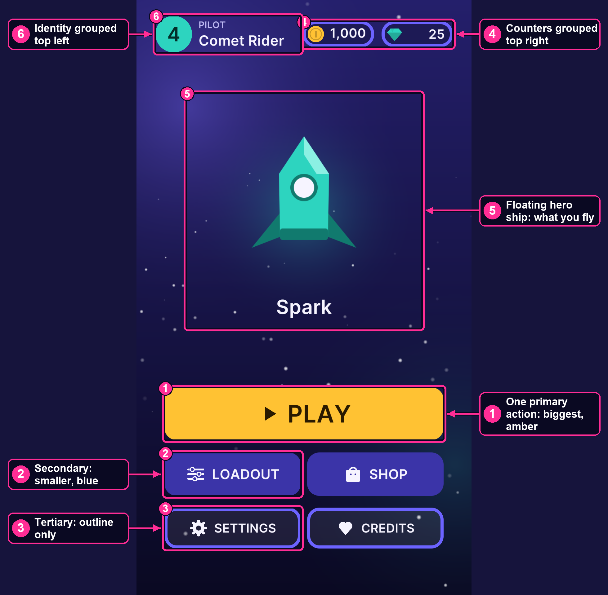

| Colour | Greyscale |
|---|---|
| 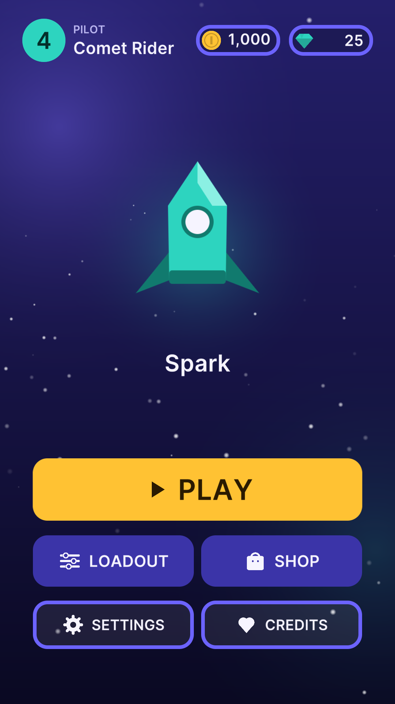 | 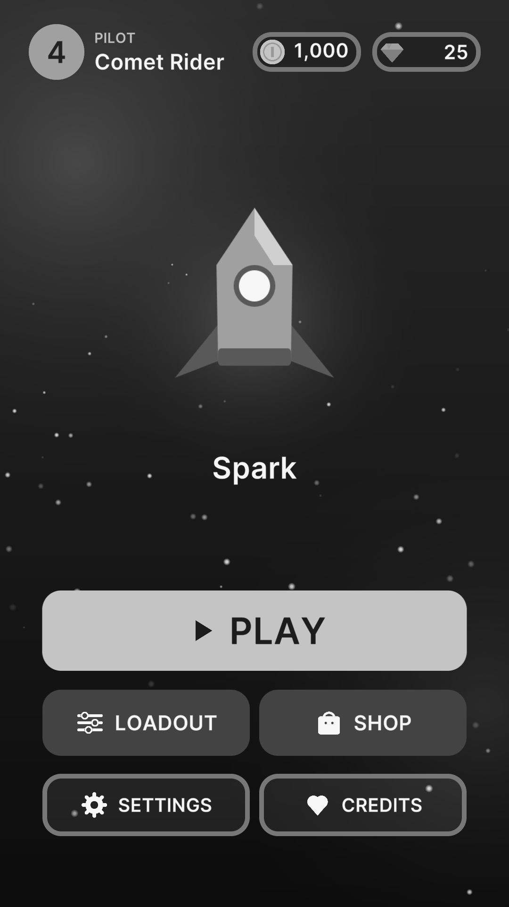 |

Purpose: the hub. Everything starts here and the obvious thing to do is Play.

1. Play is the biggest button, the only amber one, and it has an icon.
2. Loadout and Shop are smaller and blue, also with icons.
3. Settings and Credits are outline only, so they are there but quiet.
4. Coins and gems sit together in the top right, where players look for them.
5. The ship you have equipped floats over a teal glow, so the menu shows your own progress.
6. Who you are (level badge and name) is in the top left.

Motion: the blocks pop in from top to bottom (scale 0.85 to 1 with OutBack in 0.4 s, fade OutQuad, 0.07 s apart), which is the reading order and leads the eye down to Play. The ship floats 16 px up and down (InOutSine, 1.8 s). Buttons shrink to 0.94 on press (OutQuad, 0.08 s) and spring back with OutBack (0.25 s).

Greyscale: Play is the biggest light area, the blue buttons are mid grey and the outline buttons are the darkest, so the three levels of importance still show. I changed nothing.

### 3. Mode select

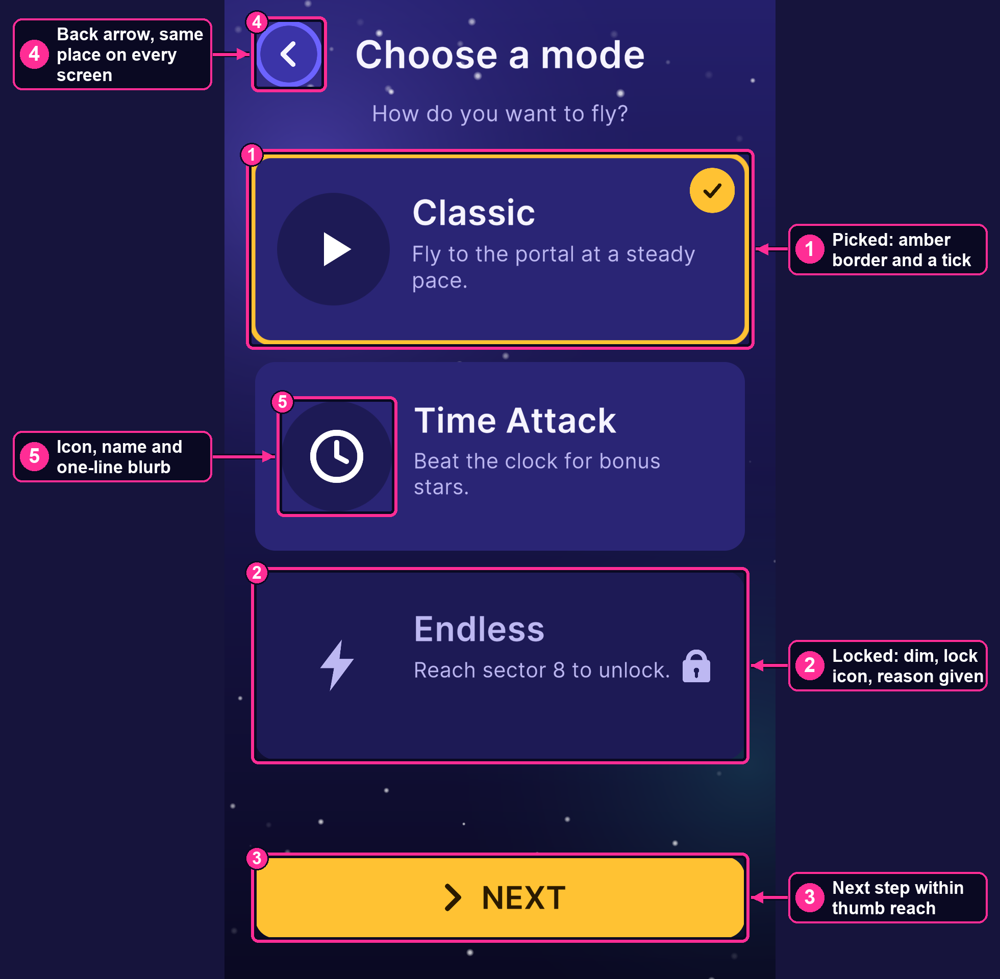

| Colour | Greyscale |
|---|---|
|  | 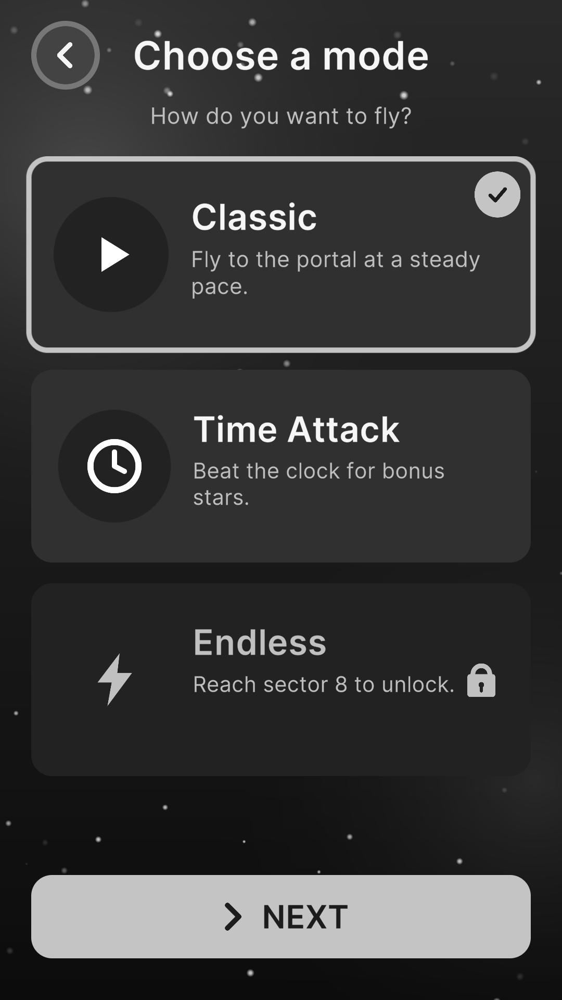 |

Purpose: choose how to play before choosing a sector.

1. The picked card has a thick amber border and a tick badge. The border is also the lightest outline in greyscale.
2. Endless is locked: a darker card, dim text, a lock icon and a sentence that says how to unlock it. Tapping it shakes it and shows a message.
3. Next is at the bottom, where the thumb already is.
4. The back arrow is in the same place as on every other screen.
5. Each card has the same parts in the same places: icon, name and one line of text.

Motion: the cards rise into place one after the other (move OutCubic 0.45 s, fade OutQuad, 0.09 s apart). When you pick one, the border changes colour (OutQuad, 0.2 s), the card grows to 1.02 (OutBack, 0.3 s) and the tick pops in (OutBack, 0.35 s). A locked card shakes for 0.4 s with a swing that dies away (linear, so it fades evenly) and a message drops in with OutBack and leaves with InCubic.

Greyscale: the picked, normal and locked cards come out as three different greys, and the lock icon and the text say it as well. I changed nothing.

### 4. Level select


| Colour | Greyscale |
|---|---|
| 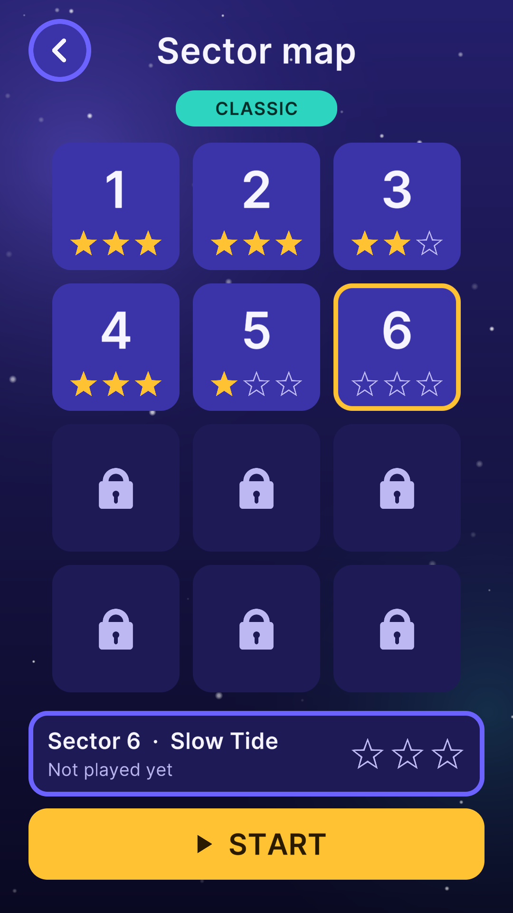 | 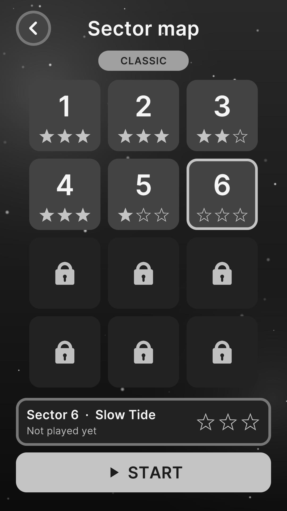 |

Purpose: pick one of 12 sectors and see how you did in it. The tiles are a 3 x 4 `GridLayoutGroup`.

1. The picked tile has a thick amber border.
2. Earned stars are filled and the missing ones are outlines, so you can see what is still possible.
3. A locked tile is darker, has a lock and no number.
4. The panel under the grid repeats the name, best score and stars of the picked sector, right above Start.
5. Start is amber, full width and at the bottom.
6. A small teal chip reminds you which mode you chose.

Motion: the tiles pop in as a wave from the top left corner (scale 0.7 to 1 with OutBack, delayed by row plus column times 0.05 s). The wave makes it feel like a map and not a list. Picking a tile gives it a small punch (1.08 back to 1, OutBack, 0.35 s) and the info panel punches too, so the eye follows the change.

Greyscale: locked tiles are clearly darker than open ones, and the picked tile is the only one with a bright border. I changed nothing.

### 5. Loadout


| Colour | Greyscale |
|---|---|
| 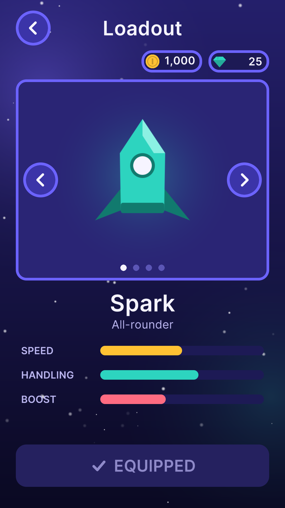 |  |

Purpose: look at the ships, compare their stats and equip one.

1. The stage can be swiped as well as tapped.
2. The arrows are 132 px circles.
3. A stat is a word plus a bar, each bar in its own colour (amber, teal, coral), so it still reads without the colour.
4. The Equipped button is dim but keeps a tick and the word EQUIPPED. For a ship you don't own the same button becomes "UNLOCK 800" with a lock, and pressing it opens the shop.
5. The coin and gem counters stay visible while you decide what to buy.
6. Four dots show which of the four ships you are looking at.

Motion: when you browse, the ship slides out and fades (InCubic, 0.16 s), then the next one slides in from the other side (OutCubic, 0.3 s), in the direction of the arrow or swipe. The stat bars grow from zero (OutCubic, 0.5 s), each one 0.08 s after the one before. Equipping gives the ship a punch to 1.15 with OutBack.

Greyscale: the three stat bars are slightly different greys but each has its label, so nothing depends on colour. The disabled button is the dimmest thing but its tick and word are still readable. I changed nothing.

### 6. Shop


| Colour | Greyscale |
|---|---|
| 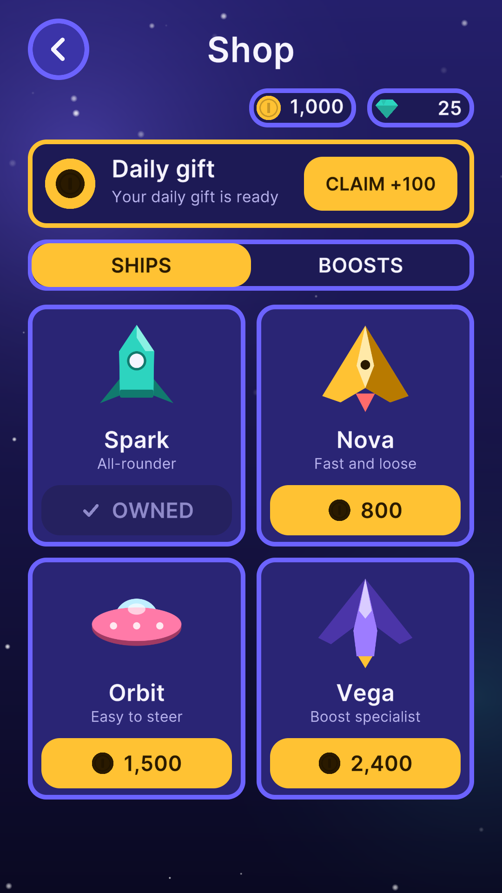 | 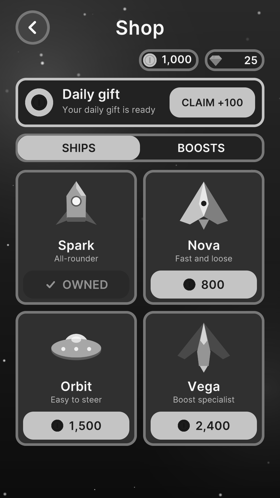 |

Purpose: spend coins on ships and boosts and claim the free daily gift. The cards are a two column `GridLayoutGroup`.

1. The daily gift banner has an amber outline and sits right under the counters, so the free thing is seen first.
2. Ships and Boosts are tabs. The amber pill shows which one is open, and the label on it is dark.
3. The price is the button, with the coin icon and the number, so there is nothing else to tap.
4. Something you own goes dim and says OWNED with a tick. It can't be pressed.
5. Coins and gems stay at the top.

Motion: when you switch tabs the old grid slides 120 px and fades out (InCubic, 0.2 s) while the new one slides in from the same side (OutCubic, 0.32 s), and the pill under the labels slides across (OutCubic, 0.25 s). When you buy something the card punches (1.06, OutBack) and the coin number counts down (OutQuad, 0.6 s) instead of jumping, so you can see what it cost. With too few coins the card shakes and a message says why. Claiming the gift punches the button, counts the coins up and turns the button into a dim TOMORROW.

Greyscale: the OWNED button is clearly dimmer than the price buttons, and the amber tab is the lightest area of the tab bar. I changed nothing.

### 7. Settings

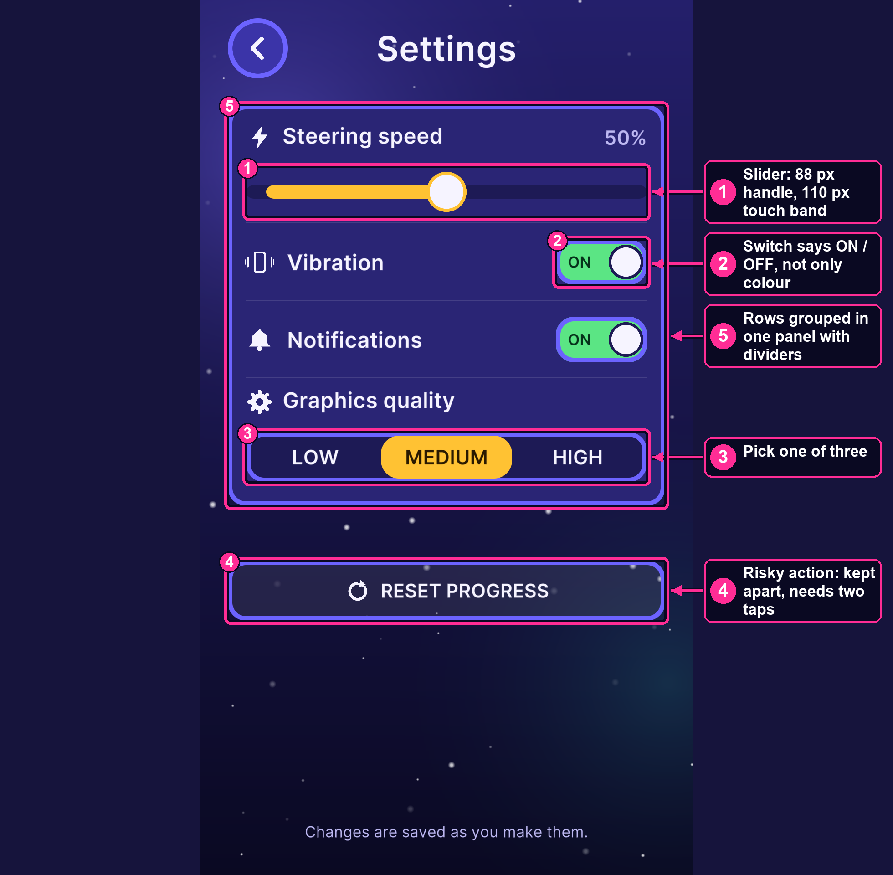

| Colour | Greyscale |
|---|---|
|  |  |

Purpose: change how fast the ship follows your finger, vibration, notifications and graphics quality. Every change is saved straight away.

1. The steering slider has an 88 px handle and a 110 px tall touch band. The percentage is written next to the name, and the value really changes how quickly the ship follows your finger in the game screen.
2. A switch has the word ON or OFF written inside it and the knob moves to the other side, so the state isn't only a colour.
3. Low, Medium and High is a segmented control. Exactly one is picked and it gets the amber pill.
4. Reset progress is kept apart from the rest and needs two taps. The first tap changes the label to "TAP AGAIN TO CONFIRM" and draws a coral border, and it relaxes again after 3 seconds.
5. The rows share one panel, with a thin divider between them and an icon in front of each name (a vertical layout group lays them out).

Motion: the rows pop in one after another (OutBack and OutQuad). The switch knob slides with InOutCubic (0.22 s) and the track changes colour with the same curve, so the two move together. The pill on the segmented control moves with OutCubic (0.25 s).

Greyscale: this is the one place where I had to change something. In my first version the "ON" text was white on a bright green track and the white knob almost vanished in greyscale. I made the ON text dark and gave the knob a dark rim, then checked again. Now both are clear.

### 8. Pause

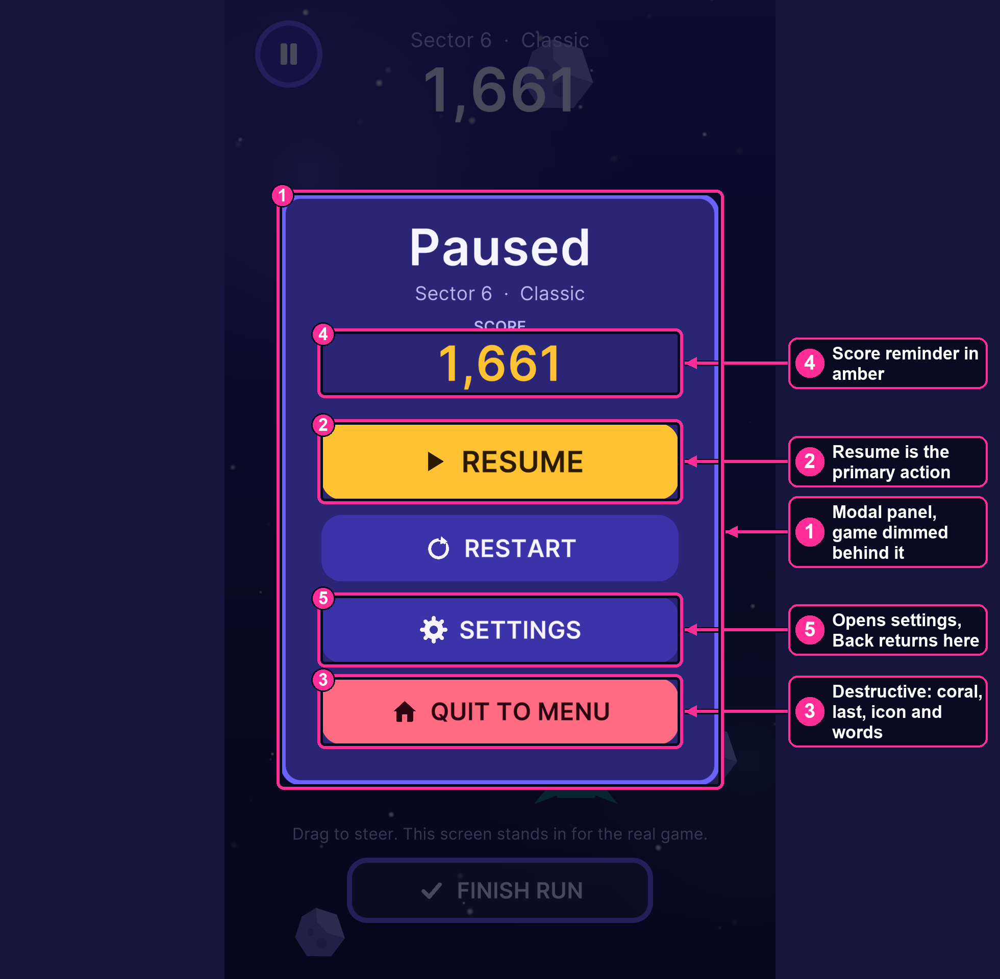

| Colour | Greyscale |
|---|---|
|  | 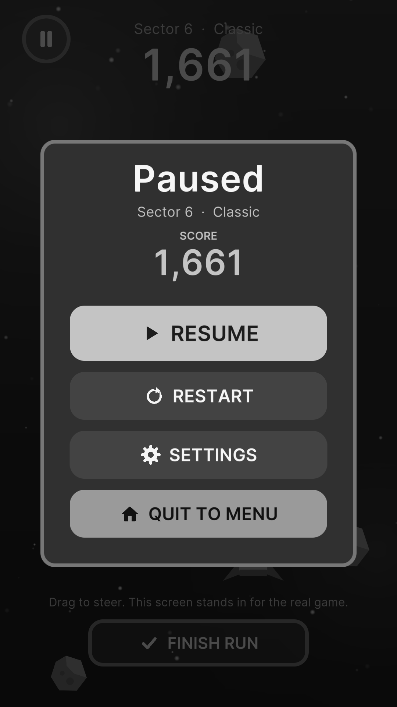 |

Purpose: stop the game without losing it and offer the four things you may want to do next.

1. It is an overlay. The game stays visible but dimmed behind it, and `Time.timeScale` is 0 so the score really stops (my test checks that).
2. Resume is amber and the biggest button.
3. Quit to menu is coral, comes last, and has both a home icon and words.
4. The sector name and the current score are at the top of the panel.
5. Settings opens the settings screen, and its back arrow comes back here.

Motion: the dark layer fades to 72% (OutQuad, 0.25 s) while the panel scales from 0.82 to 1 with OutBack (0.38 s), and the four buttons pop in after each other. Closing it fades the overlay out with InQuad (0.2 s), so it leaves faster than it arrived.

Greyscale: Resume is clearly the lightest. Quit is a bit lighter than Restart and Settings (coral is brighter than the blue) but it also has its own icon and words, so it doesn't depend on that. I changed nothing.

### 9. Results

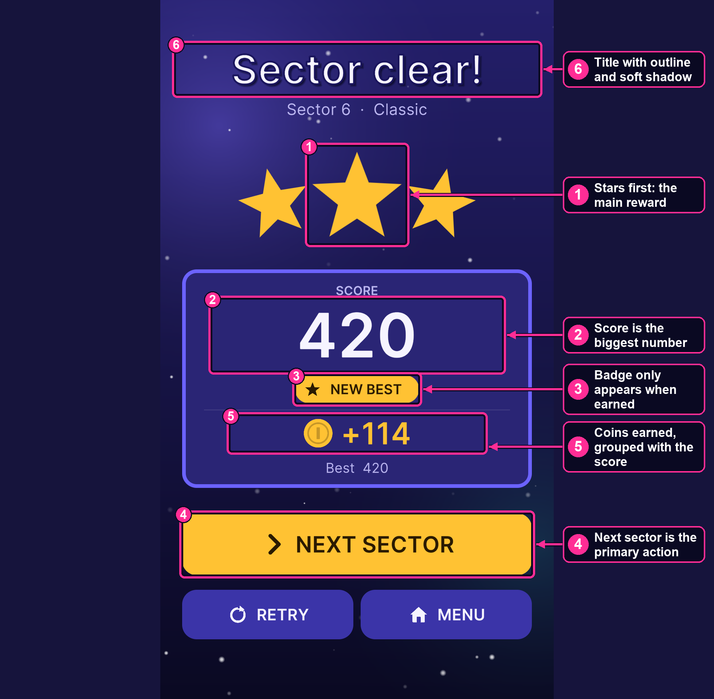

| Colour | Greyscale |
|---|---|
| 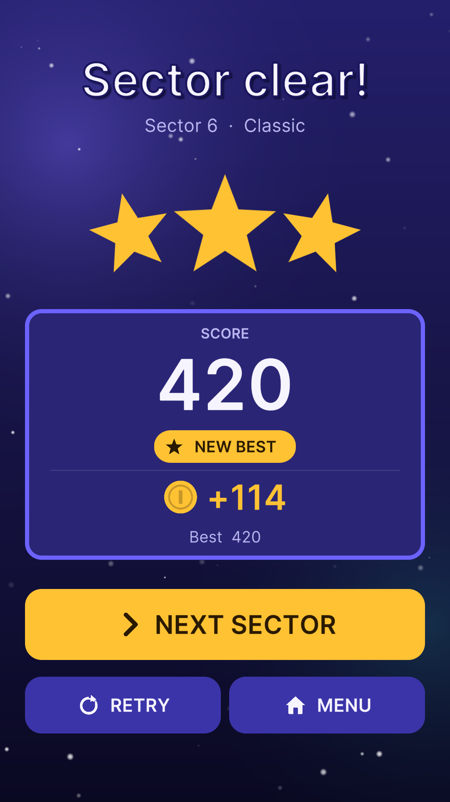 | 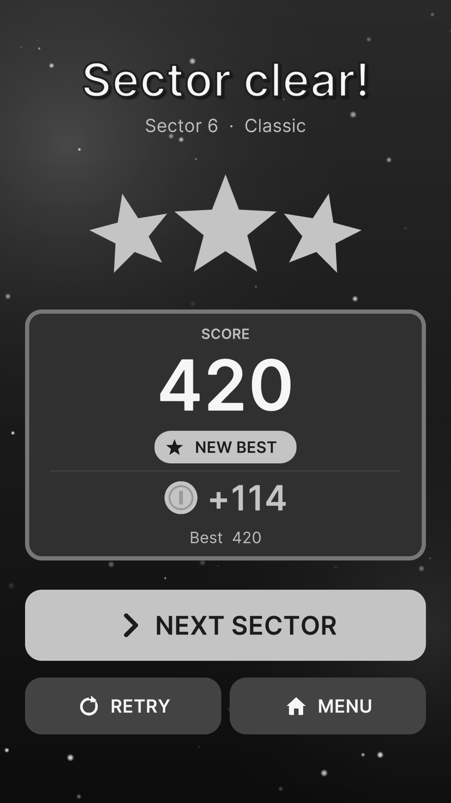 |

Purpose: tell the player how the run went, most important thing first, and say what to do next. A lost run uses the same screen. It says "Run over", the stars stay empty and the buttons become Try again, Loadout and Menu.

1. The stars come first and the middle one is the biggest. Earned stars are filled amber, missing ones are outlines.
2. The score is the biggest number, in white on the panel.
3. The NEW BEST badge only appears when the score really is a new best.
4. Next sector is amber and full width. Retry and Menu are smaller and blue.
5. Score, coins earned and best score sit together in one panel.
6. The title has an outline, like the logo, because this is the big moment.

Motion: everything is revealed in order. The title drops in (OutBack, 0.55 s), the stars pop one by one (OutElastic, 0.75 s, 0.3 s apart), the score counts up (OutCubic, 1.2 s), the coins count up (OutQuad, 0.9 s), the badge pops (OutBack, 0.5 s) and last the buttons rise (OutCubic, 0.45 s), so the eye ends on what to do next. OutElastic is only used here. It is the strongest curve I use and I kept it for the strongest moment.

Greyscale: the stars, the score and the amber button are the lightest things, in the same order as in colour. I changed nothing.

### 10. Credits


| Colour | Greyscale |
|---|---|
| 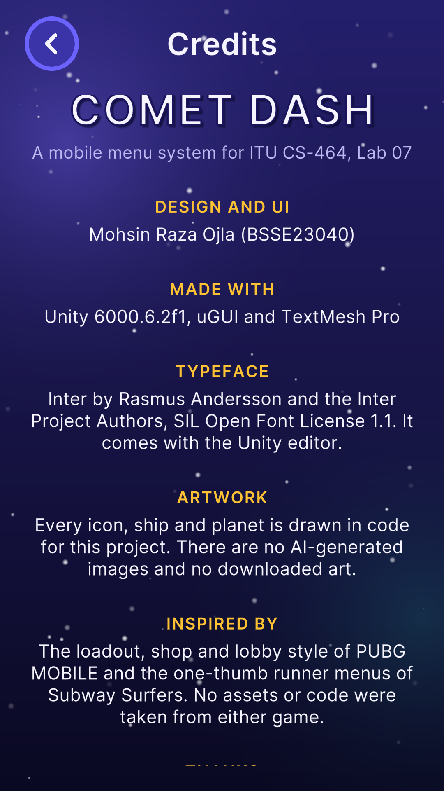 | 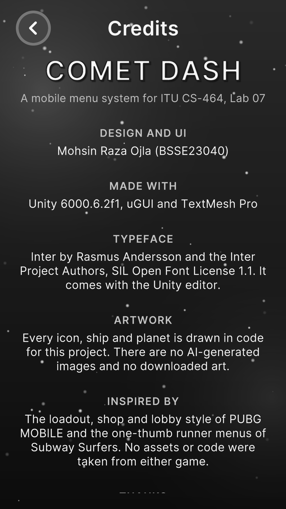 |

Purpose: say who made what and where the font and the ideas come from.

1. The text rolls up by itself at a constant 90 px per second. If you touch the screen it stops so you can scroll by hand, and it carries on 1.5 seconds after you let go.
2. Headings are amber spaced capitals and the content is white.
3. The back arrow is always there.
4. The logo uses the same outlined style as the title screen.

Motion: the roll is a Linear tween. A constant speed is the one case where easing would make things worse, because the text would speed up and slow down while you are reading it.

Greyscale: the amber headings turn into a mid grey while the body text stays almost white, so they are different, and the headings are also small spaced capitals. I changed nothing.

## What I changed after looking at the greyscale pictures

I looked at all ten greyscale copies. Only the switches on the settings screen needed a fix (see screen 7). In the other places where two things could have merged, such as the quit button next to the blue buttons or locked and open tiles, there was already an icon, a word, a border or a different brightness.

## How I tested it

I wrote an editor script (it is not in the repo) that opens the scene in play mode and clicks the real buttons through the whole menu: title, main menu, mode, level, game, pause, settings and back, results, loadout, shop (buying, not having enough coins, boosts, the gift), reset, credits, and a second run to the next sector. After every step it checks which screen is open and what the data says. That was 52 checks and all of them pass, and nothing logged an error. While I was building it, it caught three real bugs: a back button loop in the pause menu, the very first tween of a session cancelling itself, and the loadout forgetting which ship you were looking at when you came back from the shop.

## Credits and references

- Font: [Inter](https://github.com/rsms/inter) by Rasmus Andersson and the Inter Project Authors, SIL Open Font License 1.1. I used the copy that comes with the Unity editor. The license text is in `Assets/Fonts/Inter-LICENSE.txt`.
- Engine and packages: Unity 6000.6.2f1, uGUI and TextMesh Pro.
- Art: every sprite (rounded boxes, icons, ships, planet, comet, rocks) is drawn by my own code in an editor script. There are no AI-generated images, no downloaded art and no asset store packages.
- Easing curves: the formulas are the usual ones from [easings.net](https://easings.net) (Robert Penner's easing equations). The tween code around them is mine.
- Inspiration only: the lobby, loadout and shop style of PUBG MOBILE (a dark screen with one bright main button, a ship or character to look at, and a currency bar) and the one-thumb runner menus of Subway Surfers (bright cards, a level map, a results screen with a count-up). I took no assets or code from either game, and the colours, icons and layouts are my own.
- Course: the CS-464 lecture notes on colour, type, hierarchy and motion.

## Folders

```
Assets/Scenes     Menus.unity, the only scene
Assets/Scripts    ScreenManager, one script per screen, Tween, PlayerData and some small widgets
Assets/Art/UI     the sprites (PNG, drawn in code)
Assets/Fonts      Inter, its TextMesh Pro font assets and the license
Docs/screens      colour, annotated and greyscale screenshots used above
```

## Git

I worked on the `development` branch with small commits: data and tween code first, then the screens, then the sprites and the scene, then fixes. It was merged into `main` with a pull request.
